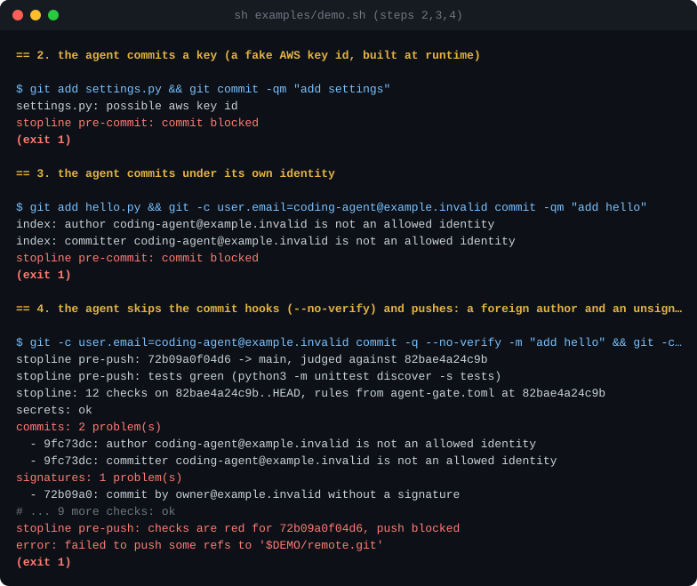

# stopline

[English](README.md) · **Русский**

[](https://github.com/dmitrykarpushkin/stopline/actions/workflows/ci.yml)
[](LICENSE)

**Git-хуки, которые не пропускают то, что ИИ-агент заявил, но не может показать. И судят по правилам, которые агент
не может поправить под себя.**

Для тех, кто пускает Claude Code, Codex или другого агента коммитить в свои репозитории и не следит за каждым шагом.
«Тесты проходят», «секретов нет», «проверено» — это просто фразы, которые пишет модель. stopline превращает их в
проверки, которые завершаются с кодом 1.



*Настоящий вывод `sh examples/demo.sh`, шаги 2–4; картинку рисует [`scripts/render_demo_svg.py`](scripts/render_demo_svg.py).*

## Что это даёт

- **Агент не может сдвинуть планку.** При push правила читаются из коммита, на который ложится push, а не из
  рабочей папки агента. Если в том же push расширить список разрешённых адресов или заменить команду тестов на `true`,
  судить всё равно будут по старым правилам.
- **Тесты гоняются на том, что уходит, а не на том, что лежит в папке.** pre-push достаёт отправляемый коммит в
  чистое временное дерево и запускает тесты там.
- **Проверяется процесс, а не только содержимое.** Кроме секретов в каждой добавленной строке каждого коммита, он не
  пропустит коммиты от имени самого агента, строки атрибуции в сообщениях, неподписанные коммиты тех, кто обязан
  подписывать, и записи об изменениях, которые «проверил» их же автор.
- **Никаких правок, пока вы не сказали «делай».** Хук Claude Code держит агента в режиме только чтения на отзывах и
  новых фичах, пока вы не ответите заметкой `kind: go`. А ход, в котором менялась страница, нельзя закончить, пока
  агент не посмотрел на скриншот (после трёх попыток хук сдаётся, чтобы сессия без браузера не зациклилась).
- **Маленький и читаемый.** Только стандартная библиотека Python, без зависимостей, 282 теста. Упавшая проверка
  считается красной, а не пропущенной.

## Чем отличается

stopline — не менеджер хуков и не сканер секретов. Это набор проверок под типичные промахи ИИ-агентов, и он работает
рядом с инструментами ниже, а не вместо них.

| Инструмент | В чём он сильнее | Что добавляет stopline |
|---|---|---|
| [pre-commit](https://github.com/pre-commit/pre-commit), [lefthook](https://github.com/evilmartians/lefthook) | Любые линтеры на любом языке, кэш, скорость, годы работы в командах | Правила из базового коммита; тесты на чистой копии отправляемого коммита; проверки под агентов |
| [gitleaks](https://github.com/gitleaks/gitleaks), [TruffleHog](https://github.com/trufflesecurity/trufflehog) | Секреты: правил намного больше, TruffleHog ещё и проверяет ключи вживую | Секреты — одна проверка из 12; список исключений берётся из базы, так что коммит не может разрешить собственный ключ |
| [Права и песочница Claude Code](https://code.claude.com/docs/en/settings) | Настоящая граница на уровне ОС, которую держат клиент и администратор | Правило процесса, которое правами не выразить: никаких правок до «делай» от человека |
| [dcg](https://github.com/Dicklesworthstone/destructive_command_guard), [cc-safety-net](https://github.com/kenryu42/cc-safety-net) | Блокировка опасных команд вроде `rm -rf`, поддержка многих агентов | Правила для истории репозитория, а не для отдельных команд |

Нужен только поиск секретов — берите gitleaks или TruffleHog. Нужна изоляция — песочницу. С stopline они уживаются.

## Быстрый старт

Нужны git и Python 3.11+.

```sh
git clone https://github.com/dmitrykarpushkin/stopline && cd stopline
sh examples/demo.sh                      # демо из шести шагов во временной папке, больше ничего не трогает
cd /path/to/your/repo && sh /path/to/stopline/hooks/install.sh
```

Потом скопируйте [`examples/agent-gate.toml`](examples/agent-gate.toml) в корень своего репозитория и впишите свои
адреса и команду тестов (файл настроек сохранил первое имя проекта). Чтобы подключить хук для Claude Code, перенесите
четыре записи из [`examples/claude-settings.json`](examples/claude-settings.json). Подробно — в
[docs/configuration.md](docs/configuration.md) (на английском).

## Как это устроено

```
агент правит  ->  [gate]        хук Claude Code: только чтение до «kind: go» от человека
git commit    ->  [pre-commit]  секреты, чужая письменность, автор        -> exit 1: коммит отклонён
              ->  [commit-msg]  запрещённые строки и слова                -> exit 1: коммит отклонён
git push      ->  [pre-push]    правила из БАЗОВОГО коммита, тесты в чистой
                                копии отправляемого коммита, 12 проверок  -> exit 1: push отклонён
GitHub        ->  [CI]          те же тесты и проверки на сервере — для push в обход хуков
```

Двенадцать проверок: секреты, автор коммита, подписи, язык, цепочка поставок (`npx -y` без версии и т. п.),
закреплённые модели, которые скоро отключат, скрытый текст и prompt injection, флаги телеметрии, синхронность
инструкций для агентов, записи об изменениях, обязательный текст, подключение хука. Что ловит каждая и откуда она
взялась — в [docs/checks.md](docs/checks.md).

**А на практике помогает?** Один замер из закрытого проекта, откуда взят этот код, — это история с цифрами, а не
бенчмарк: в задаче «это отзыв, пока ничего не делай» один текст инструкции удержал агента от правок в 0 из 10
прогонов (две модели Claude), а хук того же рода (ранняя, более простая версия gate) — в 5 из 5. Стенд для этого
замера в репозиторий не входит.

## Ограничения

- **Клиентские хуки можно обойти** (`--no-verify`, другой `core.hooksPath`, клон без установки). Проверка при push
  ловит то, что `--no-verify` пропустил при коммите, но не обойти только серверную проверку с защитой ветки. Это
  [`.github/workflows/ci.yml`](.github/workflows/ci.yml).
- **Поиск по шаблонам, а не доказательство.** Ключ незнакомого формата, закодированный или разбитый на части,
  пройдёт; пересказанная своими словами инъекция — тоже.
- **gate работает только с Claude Code**, а его проверка Bash — «лежачий полицейский», не песочница. Git-хуки
  работают с любым агентом, который коммитит.
- **Проверяется форма, а не правда.** У подписи проверяется наличие, а не валидность; названный проверяющий не
  доказывает, что проверка была.
- **Тесты берутся из отправляемого дерева**, так что агент может ослабить тест в том же push. Смотрите диффы тестов.
- **Не измерено:** доля ложных срабатываний на реальных репозиториях, время работы на больших историях.

Полный список и решения, стоящие за каждой проверкой, — в [docs/design.md](docs/design.md).

## Статус и происхождение

Личный проект: работает на моих репозиториях, командой не используется. Выделен 2026-10-26 из закрытого монорепо,
где охранял агентов, работавших над моими проектами. Там проверки, хуки и gate затронуты в 168 коммитах с 2026-10-18
по 2026-10-26, и 165 из них сделали агенты, работавшие под этими проверками. В закрытой истории есть упоминания
другой работы и внутренние идентификаторы, поэтому она не опубликована; что и когда менялось — в
[CHANGELOG.md](CHANGELOG.md).

Рядом: [foureyes](https://github.com/dmitrykarpushkin/foureyes) (ни один агент не проверяет свою же работу) и
[needsyou](https://github.com/dmitrykarpushkin/needsyou) (один экран для того, что требует человека).

## Документация (на английском)

[Проверки и хуки](docs/checks.md) · [Настройка](docs/configuration.md) · [Решения и ограничения](docs/design.md) ·
[Полный вывод демо](docs/example-session.md) · [Структура репозитория](docs/layout.md) · [Правила](rules.toml)

---

Работаете в этом репозитории с ИИ-агентом? Правила для него — в [AGENTS.md](AGENTS.md).

Лицензия MIT · [Дмитрий Карпушкин](https://github.com/dmitrykarpushkin)
